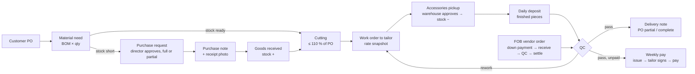

# Sistem PPIC DBRAU — production planning for a bag & wallet workshop

> **Showcase repository.** The production source code is private. This repo holds a description of the system, a process diagram and a few rewritten, runnable code samples. It contains no production code, data, credentials, or personal data about tailors or staff.

**PT DBRAU Rahadian Utama** makes bags and wallets with in-house tailors (cut-make-trim) and outside FOB vendors. **Sistem PPIC** is the web app that plans and tracks production from the customer's purchase order to the delivery note, including materials, cutting, work orders, quality control and the weekly pay of every tailor.

## The problem it solves

- Pieces handed out to tailors, returned, rejected and reworked were tracked on paper, so **work in progress and material stock leaked**.
- **Weekly pay was calculated by hand**: rates differ per tailor and per article, and cash advances had to be remembered.
- Buying materials had **no link to actual purchase orders**: no one could see whether a PO was ready to cut.

## Process (upstream → downstream)



## What it does

- **Purchase orders & material planning.** BOM per piece × PO quantity, readiness per PO, automatic draft purchase requests for shortages, partial approval when cash is tight.
- **Purchasing & warehouse.** Purchase notes with receipt and transfer proof (camera upload), goods receipt that can arrive in parts with variance reasons, unit conversion (roll / yard → metre) that updates material cost, goods-out slips, a stock ledger that never goes negative.
- **Cutting & work orders (SPK).** Cutting capped at 110 % of the PO. Work orders bundle several articles. Accessories are released only after the warehouse approves. Printable SPK, accessory list and sew-in labels.
- **Tailor load.** Each tailor's capacity is set by article difficulty. A tailor at 100 % load or more is held back from new work orders. → [`examples/Planning.php`](examples/Planning.php)
- **Quality control.** Pass or rework. Rework goes back to the tailor and is re-inspected.
- **Weekly pay in three steps.** Issue → the tailor confirms and signs on screen → pay with transfer proof. Cash advances are deducted automatically, and payment is refused before the signature. → [`examples/Wages.php`](examples/Wages.php)
- **FOB vendors.** Orders with configurable down payment, receiving, QC and settlement slips.
- **Documents.** On-screen signatures for work orders, delivery notes, pay slips, purchase notes and goods in/out. One archive to find and reprint any document.
- **Dashboards.** Operations, payments and a predictive dashboard (capacity versus open POs), plus tailor and vendor progress in one screen.
- **Roles.** Director, Head PPIC, PPIC, Warehouse, QC and Finance, plus a mobile portal for tailors. Money figures are visible only to the roles that need them, and changes to tailor data need the director's approval.
- **Operations.** Audit log of every change with passwords and photos masked, an in-app feature-request and bug tracker, an in-app guide with tours and a PDF manual, and one-click deployment from GitHub with automatic backups.
- **Integration.** Exchanges purchase orders and deliveries with the brand's own ERP ([Moaya Ops](https://github.com/bangjek-tech/moaya-ops-showcase)) through API keys, with a reconciliation view.

## Tech stack

PHP 8.2 · SQLite · single-page app in plain JavaScript · SVG charts · installable PWA · Apache hardening (data and library folders blocked, HTTPS forced) · automatic schema migrations with a backup before each one. Built with Claude Code as an AI pair programmer.

## Code samples

Rewritten from scratch for this repo, with demo data only.

```bash
php tests/run.php
```

- [`examples/Wages.php`](examples/Wages.php): pay from QC-passed pieces at the rate snapshot, rework frozen, advance deducted, and a state machine that refuses payment before the tailor signs.
- [`examples/Planning.php`](examples/Planning.php): material requirement and shortage, the 110 % cutting cap, and the tailor-load hold.

## Ringkasan (Bahasa Indonesia)

Sistem PPIC untuk konveksi tas & dompet PT DBRAU Rahadian Utama, dari PO klien sampai surat jalan:
- kebutuhan bahan, pengajuan dan nota belanja, barang masuk;
- cutting, SPK penjahit, QC dan rework;
- gaji Sabtu tiga tahap dengan TTD penjahit dan potongan kasbon otomatis;
- order FOB, arsip dokumen, dashboard prediktif.

Repo ini hanya etalase: kode produksi tetap privat, tanpa data asli atau data pribadi penjahit.

---

© 2026 M Dzaky Rahadian. All rights reserved. The samples are published for reading and review.
